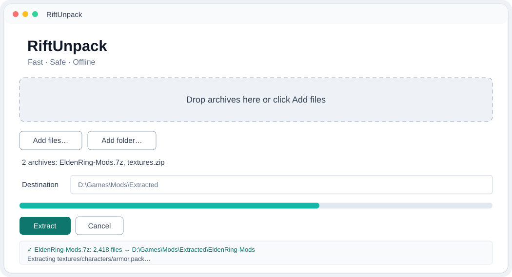

# RiftUnpack

**One fast, safe, offline-first extractor for everyday archives and game mods.** ZIP and TAR support works with Python's standard library; optional backends unlock more formats. No account, cloud upload, telemetry, or password guessing.



> v1.0.0 — Python 3.10+. Windows and Linux CI; Windows portable executables are attached to the GitHub Release when the release workflow completes.

## What it does

- Detects archive formats from file signatures, not just extensions.
- Extracts one or many archives, scans folders recursively, filters members with masks, lists contents, and checks CRC/integrity.
- Protects against Zip Slip/path traversal, symbolic links, decompression bombs, excessive file counts, and excessive expansion ratios.
- Supports password prompts (no brute force), nested extraction with a depth cap, overwrite/skip/rename conflict policies, filename-encoding overrides, and parallel archive batches.
- Preserves file timestamps and basic permissions where supported by the format and platform.
- Optional Tkinter desktop interface and Windows Explorer context-menu installer.
- Runs locally and offline after its chosen backends are installed.

## Supported formats

| Format | Backend / notes |
|---|---|
| ZIP | Built in (`zipfile`); encrypted entries supported when the ZIP uses compatible encryption |
| TAR, TAR.GZ, TAR.BZ2, TAR.XZ | Built in (`tarfile`) |
| GZ, BZ2, XZ | Built in single-stream decompression |
| 7z | `py7zr`; alternatively install 7-Zip |
| RAR | `rarfile` plus UnRAR, unar, or 7-Zip executable |
| ZST | Single-stream decompression with optional `zstandard` |
| ISO, CAB | Optional `libarchive-c` backend or installed 7-Zip |
| Split RAR, 7z `.001`, ZIP `.z01` | Leading archive/volume set required; backend/tool must support the split format |

Availability varies by installed backend. RiftUnpack reports exactly what to install if a backend is missing. Filename encodings default to the format standard/UTF-8 rules; use `--encoding cp866`, `cp1251`, or `shift_jis` for legacy ZIP/RAR names when supported.

## Install

```bash
git clone https://github.com/GhosTnever-lkm/riftunpack.git
cd riftunpack
python -m pip install .
# Optional integrations: libarchive formats, Zstandard, and drag-and-drop
python -m pip install '.[all-formats]'
```

ZIP, TAR, GZ, BZ2, and XZ work offline once Python and RiftUnpack are installed. 7z uses `py7zr` from the base install. For RAR install an UnRAR/unar/7-Zip tool. ISO/CAB need 7-Zip or the optional `libarchive-c` backend. On Linux install Tkinter through your distribution package manager if it is absent.

For development:

```bash
python -m pip install -e '.[dev,all-formats]'
```

## CLI examples

```bash
riftunpack extract ./modpack.zip
riftunpack extract ./mods-a.7z ./mods-b.tar.gz -o ./unpacked -j 2
riftunpack extract ./game-mods --recursive --include '*.pak' --include '*.ini'
riftunpack extract ./bundle.zip --deep --max-depth 3 --conflict rename
riftunpack list ./modpack.zip
riftunpack test ./modpack.zip
riftunpack extract ./legacy.zip --encoding cp866
```

Defaults cap each archive at 20 GiB expanded data, 100,000 files, and a 1000:1 compression ratio. Adjust using `--max-size-gb`, `--max-files`, and `--max-ratio`. Passwords are requested securely with `--password`.

## Desktop app

Run `riftunpack-gui` (or `python -m riftunpack.gui`). Add files or a folder, choose the destination, then extract. Drag-and-drop is provided by the bundled `tkinterdnd2` dependency. The window includes progress, a readable log, password prompts, and cancellation.

## Windows Explorer menu

After installing the CLI or building the executable, run in PowerShell:

```powershell
python packaging/install_context_menu.py "C:\path\to\RiftUnpack.exe"
```

This registers **Extract here with RiftUnpack** for the current Windows user. Remove it with `python packaging/uninstall_context_menu.py`. No administrator rights are required.

## Build portable executables

```powershell
pip install -e . pyinstaller
pyinstaller --noconfirm --onefile --name RiftUnpack --paths src packaging/cli_entry.py
pyinstaller --noconfirm --clean --onefile --windowed --name RiftUnpack-GUI --paths src packaging/gui_entry.py
```

CI runs pytest and Ruff on Windows and Linux for Python 3.10–3.12. The release workflow builds the Windows CLI and GUI `.exe` and publishes them to **v1.0.0** after checks pass. Optional runtime backends (7-Zip/UnRAR) must still be installed separately where required.

## Security notes

Archive member names are validated before writing. Extraction happens in a private staging directory inside the chosen destination, then safe regular files are copied into place. Symlinks and special filesystem objects are rejected. Size, file-count, and compression-ratio limits are configurable; do not raise them for untrusted downloads unless you understand the risk. Passwords are used only for the requested archive and are never guessed or stored. Keep external extraction tools up to date.

## Support / Pro Version

RiftUnpack is open source and community-supported. **RiftUnpack Pro** is an idea for optional power-user features: scheduled batch jobs, cloud-folder workflows, and richer exportable reports. It is not part of v1.0.0 and does not change the offline-first free extractor.

## Development

```bash
pytest
ruff check .
```

See [STATE.md](STATE.md) for the implementation checklist and known backend boundaries. Contributions and reproducible security reports are welcome.

## License

MIT. See [LICENSE](LICENSE).

## GitHub topics

`archive-extractor` · `unarchiver` · `python` · `zip` · `7z` · `game-modding` · `modding-tools` · `offline` · `security`
