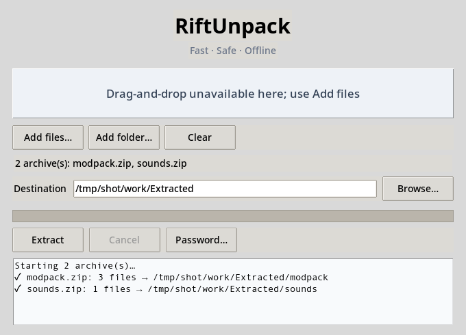

# RiftUnpack

**A fast, safe, offline archive extractor for everyday archives and game mods.** ZIP, TAR, and single-file compression work with Python's standard library plus the small dependencies installed with RiftUnpack. No account, cloud upload, telemetry, or password guessing.



*Real screenshot: the desktop app extracting two sample archives (Linux, Xvfb).*

> **v1.0.1** — Python 3.10+. Tested on Windows and Linux in CI. Windows portable executables (`RiftUnpack.exe`, `RiftUnpack-GUI.exe`) are attached to the GitHub Release.

## What it does

- Detects archive formats from file signatures, not just extensions.
- Extracts one or many archives, scans folders (optionally recursively), filters members with masks, lists contents, and checks integrity (CRC).
- Blocks path traversal (Zip Slip), symbolic links, special files, decompression bombs, excessive file counts, and excessive compression ratios.
- Prompts for passwords (no brute force), extracts nested archives up to a depth cap, applies overwrite/skip/rename conflict policies, and overrides legacy filename encodings.
- Runs archive batches in parallel (`-j`).
- Provides a CLI and a Tkinter desktop window with progress, log, password prompt, and cancel.

## Supported formats

Status reflects what the automated test suite exercises with real archive files. "Experimental" means the code path exists but RiftUnpack's tests do not verify it with real files yet.

| Format | How it is read | Status |
|---|---|---|
| ZIP | Built in (`zipfile`). ZipCrypto built in; AES needs 7-Zip | Tested |
| TAR, TAR.GZ, TAR.BZ2, TAR.XZ | Built in (`tarfile`) | Tested |
| GZ, BZ2, XZ | Built in single-stream decompression | Tested |
| ZST | Single-stream decompression with `zstandard` (installed by `.[all-formats]`) | Tested |
| 7z | `py7zr` (base install); falls back to 7-Zip when `py7zr` cannot read the archive | Tested, including password and split `.7z.001` via 7-Zip |
| ISO | `libarchive-c` (needs the native libarchive library) | Tested on Linux CI |
| CAB | Windows `makecab`-built fixture only | Tested on Windows CI only; experimental elsewhere |
| RAR | `rarfile` plus an UnRAR, unar, or 7-Zip executable | Experimental: no real RAR fixture in tests |
| Split ZIP `.zip.001` | 7-Zip | Tested |
| Split RAR `.partN.rar`, ZIP `.z01` | Detected and grouped; extraction depends on the external tool | Experimental |

Missing backends are reported with the exact package or tool to install. Filename encodings default to the format's standard rules (UTF-8 for ZIP when flagged). Legacy names can be decoded with `--encoding cp866`, `cp1251`, or `shift_jis`; these three are covered by tests.

## Install

```bash
git clone https://github.com/GhosTnever-lkm/riftunpack.git
cd riftunpack
python -m pip install .
# Optional: libarchive (ISO) and Zstandard (ZST)
python -m pip install '.[all-formats]'
```

- ZIP, TAR, GZ, BZ2, XZ and 7z work after the base install.
- ZIP AES archives and fallbacks for hard 7z archives need [7-Zip](https://www.7-zip.org/) (`7z`/`7za` on PATH).
- RAR needs an UnRAR, unar, or 7-Zip executable.
- The desktop app needs Tkinter. On Linux install it with your package manager (for example `python3-tk`).

For development:

```bash
python -m pip install -e '.[dev,all-formats]'
```

## CLI

```bash
riftunpack extract ./modpack.zip                       # sibling folder: modpack_extracted/
riftunpack extract ./mods-a.7z ./mods-b.tar.gz -o ./unpacked -j 2
riftunpack extract ./game-mods -r --include '*.pak' --include '*.ini'
riftunpack extract ./bundle.zip --deep --max-depth 3 --conflict rename
riftunpack extract ./protected.zip --password          # prompts securely
riftunpack extract ./legacy.zip --encoding cp866
riftunpack extract ./encrypted-aes.zip --seven-zip 'C:\Tools\7z.exe'   # custom 7-Zip for fallbacks
riftunpack list ./modpack.zip
riftunpack test ./modpack.zip
```

Defaults: 20 GB expanded size per archive (`--max-size-gb`), 100,000 files (`--max-files`), and a 1000:1 compression ratio (`--max-ratio`). Nested extraction is off unless `--deep` is given.

## Desktop app

Run `riftunpack-gui` (or `python -m riftunpack.gui`). Add files or a folder, choose the destination, and extract. Drag-and-drop works when `tkinterdnd2` is available (it is installed with RiftUnpack). Password prompts and cancel are available while a batch runs.

## Windows Explorer menu

Experimental: the script registers a per-user context-menu entry, but it is not covered by automated tests.

```powershell
python packaging/install_context_menu.py "C:\path\to\RiftUnpack.exe"
```

This adds **Extract here with RiftUnpack** for the current Windows user (no administrator rights). Remove it with `python packaging/uninstall_context_menu.py`.

## Build portable executables

```powershell
pip install -e . pyinstaller
pyinstaller --noconfirm --clean --onefile --name RiftUnpack --paths src packaging/cli_entry.py
pyinstaller --noconfirm --clean --onefile --windowed --name RiftUnpack-GUI --paths src packaging/gui_entry.py
```

The release workflow builds these two executables on Windows, smoke-tests them (extracts ZIP and 7z fixtures from the command line), and publishes them to the GitHub Release for the version in `pyproject.toml`.

## Security notes

Archive member names are validated before any write. Extraction happens in a private staging directory inside the destination; only safe regular files are then moved into place. Symbolic links and special filesystem objects are rejected. Size, file-count, and compression-ratio limits are configurable; do not raise them for untrusted archives unless you understand the risk. Passwords are kept in memory only for the current run (the desktop app keeps a password you set for its session) and are never written to disk or guessed.

Known limitation: the 7-Zip fallback receives the password as a command-line argument, so it can be visible to other users on the same machine while 7-Zip runs. Prefer the built-in readers when possible.

## Development

```bash
pytest
ruff check .
mypy
```

See [STATE.md](STATE.md) for the audit report, known issues, and next steps, and [CHANGELOG.md](CHANGELOG.md) for release history.

## License

MIT. See [LICENSE](LICENSE).

## GitHub topics

`archive-extractor` · `unarchiver` · `python` · `zip` · `7z` · `game-modding` · `modding-tools` · `offline` · `security`
